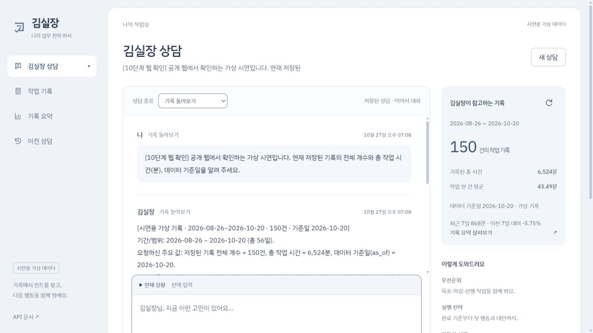
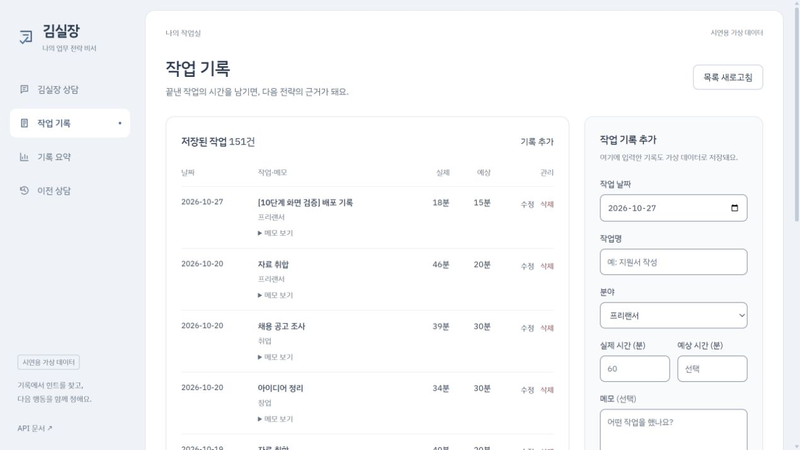
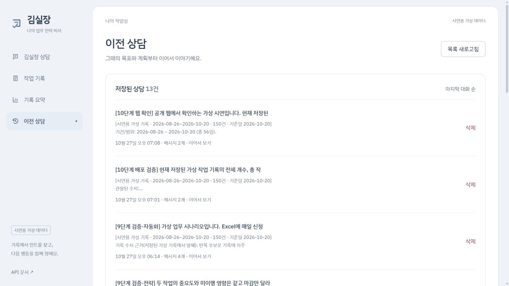
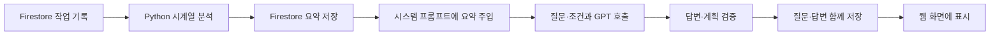

# M1-2 · 김실장

**AI Agent 개발: 나만의 AI 비서 구축**

김실장은 작업 기록을 참고해 **우선순위를 정하고, 실행 전략을 세우며, 반복 업무의 자동화 방법을 설계하는 AI 업무 전략 비서**입니다. 프리랜서·취업 준비·창업 준비처럼 여러 일이 겹칠 때, 사용자가 질문하면 목표·마감·가능 시간에 맞춰 다음 행동을 제안합니다.

현재 버전은 **가상 데이터로 구현한 공개 시연용 서비스**입니다. 자동화 상담은 설계와 검증 방법을 제안하며, 외부 프로그램을 직접 실행하거나 메시지를 전송하지 않습니다.

## 바로 접속하기

| 구분 | 주소 |
| --- | --- |
| 웹 서비스 · Vercel | [김실장 열기](https://m1-2-kim-manager.vercel.app) |
| 백엔드 기본 주소 · Render | `https://m1-2-kim-manager.onrender.com` |
| 백엔드 접속 확인 | [API 서버 상태](https://m1-2-kim-manager.onrender.com/api/health) |
| Swagger API 문서 | [API 목록과 요청 형식 확인](https://m1-2-kim-manager.onrender.com/docs) |
| GitHub 코드 | [Duebii/Codyssey · M1-2](https://github.com/Duebii/Codyssey/tree/main/M1-2) |

백엔드 기본 주소 뒤에 `/api/...`를 붙여 호출합니다. 루트 `/`는 화면을 제공하지 않으므로 접속 확인에는 위 서버 상태 또는 Swagger 주소를 사용합니다. Render 무료 서버는 사용하지 않는 동안 정지할 수 있어 첫 접속에 약 1분 걸릴 수 있습니다. 화면의 서버 준비 안내에 따라 재시도하고, 저장 여부가 불확실하면 목록·이전 상담을 먼저 확인합니다.

**데이터 제출 허용:** 2026-10-28 사용자가 과제 담당자에게 더미데이터 제출 허용을 확인받았다고 알려 주었습니다. 아래 데이터는 실제 개인 기록이나 성과 자료가 아닌 합성 데이터이며, 허용 확인의 근거는 사용자의 확인입니다.

## 핵심 기능과 사용 방법

| 기능 | 입력 | 확인할 결과 |
| --- | --- | --- |
| 데이터 기반 AI 상담 | 질문, 선택 입력으로 목표·시간·할 일·마감·중요도·선행 작업 | 저장된 요약을 반영한 답변과 근거, 로딩·오류 안내 |
| 우선순위·실행 전략 | 오늘 할 일과 사용 가능한 시간 | 우선순위 이유, 완료 기준, 단계별 시간, 첫 행동, 점검·대안 |
| 반복 업무 자동화 설계 | 실제 작업 과정·도구·입력·출력에 대한 설명 | 기록상 반복 후보와 수치, 자동화 부분·사람 확인 부분, 작은 검증 절차 |
| 기록 관리 · CRUD | 작업 날짜·실제 시간·메모·작업명·분야·선택 예상 시간 | 기록 추가·목록·수정·삭제와 최신 요약 |
| 대화 기록 | 자동 저장된 상담을 목록에서 선택 | 이전 질문·답변·당시 근거·현재 조건 복원, 이어서 상담 |

처음에는 **기록 요약**에서 가상 기록의 범위와 통계를 확인한 뒤 상담 종류를 선택합니다. 전략 상담이라면 ‘현재 상황’에 할 일과 시간을 입력하고 질문합니다. 예를 들어 “제안서 작성은 오늘, 지원서 작성은 모레 마감이고 오늘 90분 쓸 수 있어요. 두 문서의 초안을 만들 순서를 정해 주세요.”라고 물을 수 있습니다. 계획은 입력한 시간이 넘지 않도록 서버에서 검사합니다. 상담 중 시간이나 마감이 바뀌면 새 조건을 알려 다시 계획할 수 있습니다.

## 제출 화면

다음은 **2026-10-27 실제 배포 웹에서 검증한 화면**입니다. 현재 목록은 사용 중 변경될 수 있으며, 캡처를 현재 실시간 상태로 해석하지 않습니다.

### 1. 데이터 요약을 반영한 질문·답변

저장된 가상 기록 **150건·6,524분**, 기준일 **2026-10-20**을 답변과 참고 요약에서 확인합니다. 이 화면은 대화 저장 후 새로고침하여 다시 불러온 결과이기도 합니다.



### 2. 기록 관리 · 수정 결과

웹에서 시험 기록을 12분으로 추가한 뒤 18분으로 수정했습니다. 캡처의 **151건**은 임시 기록을 포함한 상태입니다. 확인 뒤 해당 기록만 삭제해 원본 **150건·6,524분**을 보존했습니다.



### 3. 이전 상담 목록과 불러오기

웹을 새로고침한 뒤 `[10단계 웹 확인]` 상담을 선택해 질문·답변·상담 종류를 복원했습니다. 목록의 제목은 위 1번 화면과 같으며, [불러온 상세 화면](docs/screenshots/stage10-20261027/chat-restored.jpg)에서 같은 질문과 답변을 비교할 수 있습니다.



[배포 검증 결과](docs/DEPLOYMENT.md)와 [전체 흐름 점검](docs/INTEGRATION.md)에 시나리오와 검증 범위를 기록했습니다.

## 데이터 선정과 분석

한 건은 **특정 날짜에 작업을 한 번 수행한 기록**입니다. 같은 날짜에 여러 건이 있을 수 있고 날짜순으로 누적 시간과 변화를 비교할 수 있어 시계열 데이터로 분석합니다. 과제의 `(date, value, memo)`를 유지하고 작업명·분야·예상 시간·가상 출처를 추가했습니다.

| 항목 | 기본 데이터 |
| --- | --- |
| 출처 | 가상 사용자 한 명의 합성 작업 기록, `source: synthetic` |
| 기간·개수 | 2026-08-26 ~ 2026-10-20, 56일 동안 150건 |
| 단위 | `value`: 작업 한 건의 소요 시간(분) |
| 기록일·미기록일 | 40일·16일. 미기록일은 `null`과 `unrecorded`로 구분 |
| 총 시간·평균·최대·최소 | 6,524분·43.49분·77분·17분 |
| 최근 추세 | 마지막 기록일 기준 최근 7일 868분 / 이전 7일 921분, -5.75% |
| 생성·재현 | 고정 기간과 난수 시드 `1021`, Python 표준 라이브러리로 재생성 가능 |

분야별 시간 비중, 작업별 수행 횟수, 예상 대비 초과 시간, 3회 이상 반복된 작업 후보를 추가로 계산합니다. 7일 집계는 첫 기록일부터 연속 7일씩 묶습니다. 최근 추세는 마지막 기록일을 기준으로 비교하며 오늘의 상황이나 성과를 뜻하지 않습니다. 의도적으로 넣은 패턴은 실제 자동화 효과의 증거가 아닙니다.

원본은 [work_records.json](data/work_records.json), 출처·생성 조건과 허용 확인은 [dataset_metadata.json](data/dataset_metadata.json), 자세한 계산 기준은 [데이터 설명](docs/DATASET.md)에 있습니다. [summary.preview.json](data/summary.preview.json)은 고정된 로컬 분석 예시이고 최신 서비스 요약은 `/api/data/summary`로 조회합니다.

## 데이터가 답변에 쓰이는 흐름



원본과 요약의 `data_revision`이 같으면 저장된 요약을 재사용합니다. 기록을 추가·수정·삭제하면 버전과 요약을 갱신하고 다음 상담에 최신 요약을 제공합니다. 과거 답변의 근거는 당시 버전으로 보존합니다.

`POST /api/chat`은 요약 API와 **같은 요약 서비스를 직접 사용**합니다. 서버가 자기 API를 HTTP로 다시 호출하지 않습니다. 요약을 시스템 프롬프트의 `RECORD_SUMMARY`에 붙이고 질문·현재 조건·최근 대화를 전달합니다. 원본 메모 전체를 보내거나 모델을 재학습하지 않습니다.

## 기술 스택과 역할 분리

| 구성 | 사용 기술·책임 |
| --- | --- |
| 백엔드 | Python 3.12.14 검증, FastAPI·Uvicorn |
| 요청·응답 모델 | Pydantic: 날짜·분 단위 정수·필수 필드·문자열 길이·작업 관계 검증 |
| DB | Firebase Firestore: 기록·요약·대화 저장, 트랜잭션으로 변경 일관성 유지 |
| AI | OpenAI Python SDK, 코디세이 제공 GPT API의 `gpt-5-mini`로 검증 |
| 프론트엔드 | HTML/CSS/JavaScript, 프레임워크 미사용 |
| 배포 | Render 백엔드 · Vercel 정적 프론트엔드 |

```text
main.py                  앱 진입점
app/routers/             URL·HTTP 메서드·요청·응답 연결
app/schemas/             Pydantic 검증과 데이터 형식
app/services/            분석·요약·상담·저장 순서 등 업무 흐름
app/repositories/        Firestore 읽기·쓰기와 트랜잭션
app/core/                설정·외부 클라이언트·공통 오류
frontend/                네 화면과 API 호출
scripts/                 데이터 생성·검증·가져오기·프론트 빌드
```

Firestore의 `data`는 작업 기록, `conversations`는 상담과 메시지, `summaries`는 분석 요약, `metadata`는 버전·갱신 상태를 저장합니다. 라우터와 업무 흐름·DB 접근을 나눠 같은 요약을 화면과 채팅에서 재사용하고 외부 연결 없이 테스트할 수 있게 했습니다.

## API

| 메서드 | 주소 | 기능 |
| --- | --- | --- |
| POST / GET | `/api/data` | 기록 추가 / 목록 |
| PUT / DELETE | `/api/data/{id}` | 기록 전체 수정 / 삭제 |
| GET | `/api/data/summary` | 최신 요약 |
| POST | `/api/chat` | GPT 상담과 질문·답변 자동 저장 |
| POST / GET | `/api/conversations` | 상담 생성 / 목록 |
| GET / DELETE | `/api/conversations/{id}` | 전체 메시지 불러오기 / 상담 삭제 |

상세 메시지는 `GET /api/conversations/{id}`로 조회하는 방식(A)을 구현했습니다. 기록 삭제와 대화 삭제는 구분합니다. 성공한 삭제는 본문 없는 `204`입니다. 잘못된 입력은 `422`, 없는 ID는 `404`, 저장 충돌은 `409`, 호출 한도는 `429`로 안내합니다. [Swagger](https://m1-2-kim-manager.onrender.com/docs)와 [API 계약](docs/API_CONTRACT.md)에서 요청·응답 예시를 확인할 수 있습니다.

## 새 컴퓨터에서 로컬 실행

미션의 최소 조건은 Python 3.10 이상이며, 이 프로젝트는 **Python 3.12.14**에서 검증했습니다. 아래는 Windows PowerShell 기준입니다. Git과 Python을 준비하고 실행합니다.

```powershell
git clone https://github.com/Duebii/Codyssey.git
cd Codyssey/M1-2
py -3.12 -m venv .venv
.\.venv\Scripts\python.exe -m pip install -r requirements-dev.txt
if (!(Test-Path .env)) { Copy-Item .env.example .env }
```

이미 저장소가 있다면 복제와 폴더 생성은 생략하고 `M1-2`에서 진행합니다. `.env`에 본인의 GPT 키와 Firestore 인증 정보를 입력합니다. 로컬 파일 방식은 `.secrets/firebase-service-account.json`에 본인 키를 보관하고 `FIREBASE_SERVICE_ACCOUNT_PATH`를 지정합니다. JSON 방식과 경로 방식을 동시에 설정하지 않습니다.

새로 준비한 본인 Firestore에 기본 데이터를 넣으려면 먼저 검증한 뒤 명시적으로 저장합니다. 이미 준비된 공개 시연 DB에는 다시 가져올 필요가 없습니다.

```powershell
.\.venv\Scripts\python.exe scripts/import_dummy_data.py
.\.venv\Scripts\python.exe scripts/import_dummy_data.py --apply
```

첫 명령은 외부 연결·쓰기 없이 검증만 합니다. `--apply`는 설정된 Firestore에 없는 ID만 추가하며 사용자 수정 기록을 덮어쓰지 않습니다.

**터미널 1 · 백엔드**

```powershell
.\.venv\Scripts\python.exe -m uvicorn main:app --reload --host 127.0.0.1 --port 8000
```

**터미널 2 · 프론트엔드** — 같은 `M1-2` 폴더에서 실행합니다.

```powershell
.\.venv\Scripts\python.exe -m http.server 5500 --bind 127.0.0.1 --directory frontend
```

[로컬 웹](http://127.0.0.1:5500), [로컬 Swagger](http://127.0.0.1:8000/docs)를 엽니다. 키가 없어도 서버 기동·Swagger·오프라인 시험은 가능하지만 실제 CRUD·GPT 상담에는 해당 인증 설정이 필요합니다. 키·모델·제공자를 바꾸면 백엔드를 재시작합니다. macOS/Linux에서는 `python3 -m venv .venv`, `.venv/bin/python`을 사용합니다.

## 환경변수

실제 값이 비어 있는 [.env.example](.env.example)을 기준으로 설정합니다. 로컬 `.env`보다 운영체제·플랫폼의 환경변수가 우선합니다.

| 변수 | 용도·값 |
| --- | --- |
| `OPENAI_API_KEY` | 선택한 제공자의 비밀 키. 백엔드 전용 |
| `FIREBASE_SERVICE_ACCOUNT_PATH` 또는 `FIREBASE_SERVICE_ACCOUNT_JSON` | 서비스 계정 파일 경로 또는 JSON 전체. 정확히 하나만 지정 |
| `AI_PROVIDER` | 제공 키는 `codyssey`, 개인 OpenAI Platform 키는 `openai`. 발급처에 맞는 서버 선택 |
| `OPENAI_MODEL` | 현재 코디세이 연결에서 `gpt-5-mini` 검증 |
| `APP_ENV` | 로컬 `development`, Render `production` |
| `ALLOWED_ORIGINS` | 로컬 `http://localhost:5500,http://127.0.0.1:5500`, 배포는 실제 Vercel HTTPS origin |
| `API_BASE_URL` | 공개 백엔드 주소. 로컬 `http://127.0.0.1:8000`, Vercel은 실제 Render HTTPS 주소. `/api` 제외 |
| `OPENAI_MAX_OUTPUT_TOKENS` | 예시 `6000`, 출력 상한 |
| `OPENAI_TIMEOUT_SECONDS` / `OPENAI_REASONING_EFFORT` | 현재 제공자 검증값 `60` / `omit` |

브라우저의 JavaScript는 플랫폼 환경변수를 직접 읽지 못하므로, Vercel 빌드가 공개 `API_BASE_URL`만 `dist/config.js`로 만듭니다. `--production` 빌드는 주소 누락·로컬 HTTP 주소·공개 대상 외 파일을 거절합니다. 배포 설정과 전체 환경변수는 [배포 안내](docs/DEPLOYMENT.md)를 따릅니다.

## 검증과 운영 범위

2026-10-27 **Python 221개·Node 14개** 시험을 통과했습니다. Firestore 실제 CRUD·요약 갱신, GPT 답변·시간 변경·자동 저장, 배포 웹의 새로고침 후 불러오기를 별도로 확인했습니다. 자동 시험은 외부 서비스를 호출하지 않으며 실제 GPT 답변 품질을 보장하는 시험은 아닙니다.

2026-10-28 상담 화면을 개선했습니다. 첫 질문 뒤 넓은 채팅 화면으로 전환하며, 질문·조건 초안과 마지막 상담을 같은 브라우저에서 복원합니다. 답변이 끝난 상담은 **이전 상담**에 자동 저장되고, 완료한 일의 **작업 기록**은 따로 등록합니다. 브라우저 초안과 서버 저장의 차이·한계는 [웹 화면 안내](docs/FRONTEND.md), 검증 결과는 [상담 복원 검증](docs/CHAT_RECOVERY_QA.md)을 참고하세요.

```powershell
.\.venv\Scripts\python.exe -m pytest --basetemp=.tmp/pytest-readme
node --test tests/frontend.test.mjs
.\.venv\Scripts\python.exe scripts/verify_dataset.py
.\.venv\Scripts\python.exe scripts/generate_dummy_data.py --check
```

API 키와 서비스 계정 JSON은 Git에서 제외하고 Render 백엔드에만 둡니다. CORS는 허용한 웹 출처를 지정하는 브라우저 정책이며 로그인이나 데이터 접근 권한을 대신하지 않습니다. 현재 공개 API는 가상 데이터 시연용이고 사용자별 분리를 제공하지 않습니다. 실제 개인 업무 기록을 운영하기 전에는 인증·접근 제어를 추가해야 합니다.

GPT 호출은 비용이 발생할 수 있어 출력·시간·입력 길이·요청 횟수를 제한했습니다. 네트워크 실패는 자동 재시도하지 않으며, 출력 형식·계획 보정은 최대 한 번 추가 호출할 수 있습니다. 최근 24시간 모델 호출 100회 제한은 서버 프로세스 기준으로 재시작 시 초기화됩니다. 기록된 시간이 줄었다고 효율이 높아졌다고 단정하지 않고, 자동화 절감 효과는 검증 전 가정으로 표시합니다.

## 제출·학습 자료

- [제출 요약과 확인 항목](docs/SUBMISSION.md)
- [학습 목표 6가지 설명과 자가점검](docs/LEARNING_GUIDE.md)
- [데이터 정의·생성·분석 기준](docs/DATASET.md)
- [API·데이터 계약](docs/API_CONTRACT.md)
- [환경 준비 상세](docs/SETUP.md), [배포 설정·검증](docs/DEPLOYMENT.md)
- [전체 흐름 검증](docs/INTEGRATION.md), [개발 워크리스트](WORKLIST.md)

로그인·사용자별 데이터 분리, 실제 작업 완료 추적, 전략 실행 결과 비교, 외부 도구 실행·Function Calling·MCP 연동은 후속 확장입니다. 실제 업무에서 계속 사용할 만큼 도움이 되는지는 실제 작업을 대상으로 입력 부담과 제안의 실행 가능성을 별도 평가해야 합니다.
