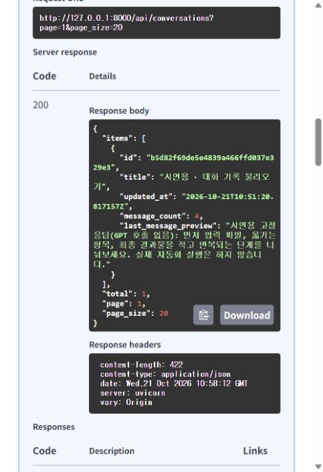
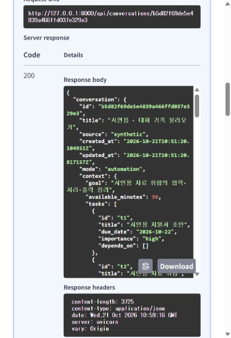

# 김실장 · 6단계 대화 저장과 불러오기

상태: **구현·156개 오프라인 테스트·실제 Firestore 저장/조회/삭제 검증 완료**.

상담을 만들고 목록에서 찾아 전체 메시지와 조건을 다시 읽을 수 있습니다. 사용자·비서 메시지 한 쌍을 함께 저장하는 내부 함수도 연결했습니다. 이 문서의 6단계 검증은 **시연용 고정 응답**을 사용했으며 GPT를 호출하지 않았습니다. 이후 7단계에서 실제 GPT 상담 4개·메시지 10개의 생성·검증·자동 저장과 재시작 후 유지를 확인했습니다. [상담 안내](CHAT.md)를 참고합니다.

## 1. API와 사용 순서

| 요청 | 성공 | 반환 내용 |
| --- | --- | --- |
| `POST /api/conversations` | `201` | 빈 상담을 만들고 `{ conversation: 상세 }` 반환 |
| `GET /api/conversations` | `200` | 목록·전체 개수·페이지. 전체 메시지는 제외 |
| `GET /api/conversations/{id}` | `200` | 선택한 상담의 전체 메시지·최신 모드·조건 |
| `DELETE /api/conversations/{id}` | `204` | 선택한 상담과 그 안의 메시지를 함께 삭제. 본문 없음 |

[Swagger](http://127.0.0.1:8000/docs)에서 **대화 기록**을 펼칩니다. 목록을 조회해 `id`를 찾고 상세 조회의 `id`에 입력하면 됩니다. 현재 **시연용 · 대화 기록 불러오기**라는 상담 1개와 메시지 4개를 확인할 수 있습니다.

새 상담 예시입니다. 제목·모드·조건을 생략하면 `새 상담`, `strategy`, 빈 조건을 사용합니다.

```json
{
  "title": "시연용 작업 정리",
  "mode": "strategy",
  "context": {
    "goal": "시연용 지원서 초안 완성",
    "available_minutes": 90,
    "tasks": [{"id": "t1", "title": "시연용 지원서 초안", "importance": "high"}],
    "constraints": "시연용 조건"
  }
}
```

`POST`는 빈 상담 생성에 사용합니다. 클라이언트가 `messages`, `source`, `revision`, `id`를 지정하거나 `system` 지시문을 저장할 수 없습니다. 메시지 자동 저장은 7단계에서 GPT 응답 검증 후 내부 `save_turn()`으로 수행합니다. 이번에는 내부 함수로 고정된 시연 메시지를 저장하고, 공개 API로 목록·전체 불러오기를 확인했습니다.

## 2. Firestore에 보관하는 내용

한 상담은 `conversations/{id}` 문서 하나입니다. ID는 서버에서 생성합니다.

- 공개 상세: ID, 제목, 출처 `synthetic`, 생성·갱신 시각, 최신 모드·상담 조건, `revision`, 전체 `messages`.
- 내부 관리: 스키마 버전 1, 사용자가 제목을 지정했는지 여부, 메시지 수와 마지막 미리보기.
- 사용자 메시지: ID, `user`, 본문, 시각, 당시 모드·상담 조건.
- 비서 메시지: ID, `assistant`, 본문, 시각, 당시 모드·조건, 답변 종류, 선택 계획, 당시 데이터 근거.
- 당시 근거: 출처, 데이터 기간·기준일, 기록 수, `data_revision`. 이후 데이터가 바뀌어도 과거 근거를 덮어쓰지 않습니다.

시각은 UTC ISO 8601 문자열입니다. 상세를 불러오는 동작은 GPT 호출이나 메시지 재저장을 하지 않습니다. 생성 시각은 추가 질문을 저장해도 유지합니다.

이름을 생략한 상담은 첫 질문의 앞 40자로 제목을 만듭니다. 제목을 명시했다면 `새 상담`이라는 제목도 그대로 보존합니다. 두 번째 질문부터는 자동 제목을 다시 바꾸지 않습니다.

## 3. 목록과 상세의 차이

목록은 `id`, `title`, `updated_at`, `message_count`, `last_message_preview`만 반환합니다. 미리보기는 마지막 메시지의 앞 100자입니다. Firestore 조회부터 필요한 필드만 선택해 전체 메시지·조건·근거를 읽어오지 않습니다.

갱신 시각 내림차순, 같은 시각은 ID 오름차순으로 정렬합니다. `page` 기본 1, `page_size` 기본 20·최대 50입니다. 첫 버전은 선택된 출처의 목록 필드를 모두 읽은 뒤 서버에서 정렬·페이지 분할합니다.

상세는 보관된 모든 메시지를 읽습니다. 목록 미리보기만으로 이전 상담의 전체 맥락을 복원하지 않습니다. 7단계 GPT 입력은 최근 최대 12개 메시지·본문 20,000자와 별도의 전체 입력 크기 한도를 적용하며 저장된 원본 이력은 삭제하지 않습니다.

## 4. 메시지 저장과 동시 변경

`ConversationService.save_turn(id, expected_revision, TurnInput)`은 서버 내부 함수이며 공개 HTTP 주소가 아닙니다.

1. 기존 대화와 버전을 읽고 조건을 병합합니다.
2. 사용자·비서 메시지에 서로 다른 ID와 당시 조건을 넣습니다.
3. 메시지 쌍, 최신 조건·모드, 제목·미리보기·메시지 수, 갱신 시각과 새 버전을 한 문서로 구성합니다.
4. Firestore 트랜잭션에서 대화 존재 여부·출처·원래 버전을 다시 검사하고 한 번에 저장합니다.

한 쌍을 저장할 때 대화 `revision`이 1 증가합니다. 두 요청이 같은 버전에서 출발하면 늦게 저장하는 요청은 `409 conversation_conflict`로 처리합니다. 새 ID를 만들어 자동 재저장하지 않습니다. 삭제한 대화에 뒤늦게 응답이 도착해도 `404`이며 상담을 다시 만들지 않습니다. 저장 실패 시 사용자 메시지만 반영되는 부분 저장도 하지 않습니다.

조건의 생략은 기존 값을 유지합니다. 명시적인 `null`은 목표·가능 시간·제약을 비우고, `tasks: []`는 작업 목록을 비웁니다. 작업 목록을 보내면 전체 교체합니다. 각 메시지의 과거 조건은 보존하고 상담 문서의 최신 조건만 갱신합니다.

## 5. 검증과 오류

- 최대 100개 메시지, 즉 50쌍입니다. 본문 총 길이는 60,000자까지이며 초과 시 `409 conversation_limit`입니다.
- 전체 직렬화 JSON을 UTF-8 기준 500KiB로 제한합니다. 계획·조건·근거도 크기에 포함하고 초과 시 `413 payload_too_large`입니다.
- `NaN` 같은 비표준 JSON 숫자를 직렬화 전에 거부합니다. 잘못된 모드·조건·서버 관리 필드는 `422`입니다.
- 없는 ID와 다른 출처의 대화는 조회·삭제 모두 `404`입니다. 다른 출처의 내용은 오류에 노출하지 않습니다.
- 저장된 대화의 역할·메시지 순서·개수·미리보기·크기가 맞지 않거나 저장소 접근이 실패하면 `503 storage_unavailable`로 안내합니다.
- 오류 응답과 로그에 메시지 본문·인증 JSON·SDK 오류 전문을 넣지 않습니다.

6단계는 메시지 저장 구조·JSON·역할·한도를 검증합니다. 7단계에서 AI가 만든 실행 계획의 단계별 시간·선행 작업·현재 조건과의 일치 검증을 추가했습니다.

## 6. 실제 클라우드 검증 — 2026-10-21

| 검증 | 결과 |
| --- | --- |
| 빈 상담 생성 | `201`, 초기 버전 0·메시지 0개 |
| 고정된 시연 메시지 두 쌍 저장 | 버전 2·메시지 4개 |
| 전체 불러오기 | `200`, 메시지·당시 근거·과거/최신 조건 동일 |
| 목록 조회 | `200`, 전체 메시지 제외·메시지 수 4·최신 미리보기 |
| 별도 임시 상담 삭제 | `204`, 이후 조회·재삭제 `404` |
| 서버 재시작 후 전체 불러오기 | 메시지 4개·과거/최신 조건·근거·생성/갱신 시각 동일 |
| 작업 데이터 영향 | 150건·6,524분과 요약 버전 156·생성 시각 모두 동일 |
| GPT 호출 | 0회 |

확인용 상담 1개를 남겼고 삭제 검증용 임시 상담은 정리했습니다. 저장·불러오기 확인용 고정 문구이며 실제 AI 상담 기록이 아닙니다.

Swagger에서 목록을 실행하고, 반환된 ID를 상세 조회에 입력해 `200` 응답을 확인했습니다.





## 7. 파일과 검사

| 파일 | 역할 |
| --- | --- |
| `app/routers/conversations.py` | 생성·목록·전체 불러오기·삭제 주소 |
| `app/schemas/conversations.py` | 요청·공개 상세·목록·내부 메시지와 저장 구조 |
| `app/services/conversations.py` | 조건 병합·제목·한도·대화 버전·메시지 쌍 구성 |
| `app/repositories/conversations.py` | 저장 계약과 대화 오류 유형 |
| `app/repositories/firestore_conversations.py` | 필요한 목록 필드 선택과 원자적 Firestore 저장 |
| `tests/test_conversations.py` | 실제 어댑터를 이용한 오프라인 검증 |

```powershell
.\.venv\Scripts\python.exe -m pytest --basetemp=.tmp/pytest-step6
```

기존 검사를 포함해 156개 테스트를 통과했습니다. 테스트 전용 Firestore 대역으로 역할 제한·조건 병합·정렬·동시 저장·삭제 후 늦은 저장·크기/개수 한도·실패 시 무변경을 확인했습니다. 기존 TestClient 전환 예정 경고 1개가 있으며 실제 클라우드 검증은 위 표와 별도로 구분합니다.
