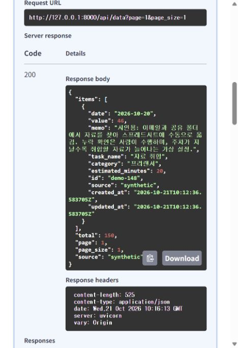

# 김실장 · 4단계 Firestore와 작업 기록 CRUD

상태: **4단계 완료 — 실제 저장·CRUD·중복 방지·서버 재시작 후 유지 확인**

2026-10-21 Firebase 프로젝트 `m1-2-mr-kim`의 `(default)` 데이터베이스(`asia-northeast3`)에 더미데이터 **150건·6,524분**을 저장했습니다. 실제 API의 추가·조회·수정·삭제, 하루 한도 검증, 중복 가져오기와 서버 재시작 후 유지까지 확인했습니다. 서비스 계정 키는 비공개 로컬 설정에 연결하고 Git에서 제외했습니다.

## 1. 구현한 범위

- JSON 또는 파일 경로 환경변수에서 서비스 계정 인증 정보를 읽습니다.
- 최초 작업 기록 요청 때 Firebase Admin 클라이언트를 초기화하고 재사용합니다. 서버 시작 시 키는 필요하지 않습니다.
- 작업 추가·조회·수정·삭제를 라우터 → 서비스 → Firestore 어댑터로 연결했습니다.
- 같은 출처·날짜의 시간 합계가 1,440분을 넘지 않도록 검사합니다.
- 원본과 기록 버전을 같은 트랜잭션에서 변경합니다.
- 중복 ID를 건너뛰고 기존 수정 내용을 보존하는 더미 가져오기 도구를 준비했습니다.
- 실제 클라우드 인증·저장·조회·수정·삭제와 서버 재시작 후 지속성을 확인했습니다.

## 2. 컬렉션과 저장 형식

| 경로 | 역할 | 현재 상태 |
| --- | --- | --- |
| `data/{id}` | 작업 기록, 출처, 생성·수정 시각 | 실제 더미 기록 150건 저장 및 CRUD 확인 |
| `metadata/synthetic` | `data_revision`, `summary_stale`, 출처, 변경 시각 | 5단계 실제 검증 후 버전 156, 요약 최신 상태 |
| `summaries/synthetic` | 계산 대상 버전과 분석 요약 | 5단계 구현·실제 저장 완료. 원본과 같은 버전 156 |
| `conversations/{id}` | 상담 조건·메시지·당시 분석 근거 | 6단계 구현·검증 완료. 시연용 상담 1개·메시지 4개 |

Firestore 컬렉션은 문서를 저장할 때 생깁니다. 현재 `data`, `metadata`, `summaries`, `conversations`가 생성됐습니다. 대화 보관 방식과 검증은 [대화 기록 안내](CONVERSATIONS.md)를 참고합니다.

`date`는 `YYYY-MM-DD` 문자열, 시간은 정수 분으로 저장합니다. 새 기록의 ID는 서버가 생성하고, 가져오기는 `demo-001` 등의 기존 ID를 사용합니다. 출처는 서버가 `synthetic`으로 고정합니다. 생성 시각은 수정 시 보존하고 수정 시각만 갱신합니다. 시각은 UTC입니다.

## 3. 인증 정보와 지연 연결

[2단계 설정 안내](SETUP.md)에 따라 프로젝트·Firestore 기본 데이터베이스·서비스 계정 키를 준비합니다. `.env` 또는 운영체제 환경변수에 아래 중 하나만 설정합니다.

- `FIREBASE_SERVICE_ACCOUNT_PATH`: 프로젝트 루트 기준 상대 경로 또는 절대 경로.
- `FIREBASE_SERVICE_ACCOUNT_JSON`: 서비스 계정 JSON 전체.

운영체제 값이 `.env`보다 우선합니다. 서비스 계정의 프로젝트 ID로 Firebase 앱을 초기화하고 기본 `(default)` 데이터베이스를 사용합니다. 실제 클라이언트 생성과 데이터 접근은 기록 요청 시 수행합니다.

키 누락·설정 오류는 값을 노출하지 않는 `503 storage_unavailable`로 안내합니다. SDK 클라이언트를 생성했다는 사실만으로 실제 연결 성공을 판정하지 않습니다. `/api/health`도 외부 저장소를 탐색하지 않고 `storage: not_checked`를 반환합니다.

## 4. API 결과

| 요청 | 정상 결과 | 주요 오류 |
| --- | --- | --- |
| `POST /api/data` | `201`, 생성된 `item` | 검증·하루 한도 `422`, ID 충돌 `409`, 연결 `503` |
| `GET /api/data` | `200`, 목록·전체 개수·페이지·출처 | 연결 `503` |
| `PUT /api/data/{id}` | `200`, 수정된 `item` | 검증·한도 `422`, 해당 출처의 기록 없음 `404`, 연결 `503` |
| `DELETE /api/data/{id}` | `204`, 본문 없음 | 해당 출처의 기록 없음 `404`, 연결 `503` |

필드와 페이지 규칙은 [API 계약](API_CONTRACT.md)을 따릅니다. 현재 소규모 데이터는 해당 출처 전체를 읽어 날짜 내림차순·ID 오름차순으로 정렬한 뒤 페이지를 나눕니다. 대규모 커서 조회는 후속 개선 범위입니다.

다른 출처의 기록은 목록에 포함하지 않고 수정·삭제도 `404`로 처리합니다. 원본 메모·인증 정보·SDK 오류 전문은 오류 응답이나 로그에 넣지 않습니다.

## 5. 시간 한도와 원자적 변경

공식 Firestore 트랜잭션 실행기를 사용하고 충돌 시 최대 3회 시도합니다.

1. 현재 출처의 메타데이터와 대상 문서를 읽습니다.
2. 생성·수정이면 같은 출처·새 작업 날짜의 기록을 읽습니다.
3. 수정 대상 자신을 제외하고 새 시간을 더해 1,440분 이내인지 확인합니다.
4. 모든 읽기 이후 원본 기록을 변경합니다.
5. 같은 트랜잭션에서 버전을 1 올리고 `summary_stale: true`를 저장합니다.

모든 변경이 같은 메타데이터 문서를 읽고 쓰므로 동시에 변경하면 충돌한 작업이 다시 읽고 검증하도록 구성했습니다. 날짜를 옮기는 수정은 이동할 날짜의 합계를 검사합니다. 검증 실패 시 원본과 버전은 바뀌지 않습니다.

4단계에서는 요약 갱신 필요 표시만 저장했고, 5단계에서 실제 분석·요약 자동 갱신을 연결했습니다. `/api/data/summary`는 최신 요약을 `200`으로 반환합니다. 계산·저장·충돌 처리와 원본 성공/요약 실패 구분은 [요약 안내](SUMMARY.md)를 따릅니다. 콘솔 등의 직접 쓰기는 앱의 버전 규칙을 건너뛰므로 기록 변경은 앱과 가져오기 도구를 사용합니다.

조회에는 10초 제한을 두고 SDK 조회 재시도는 끕니다. 트랜잭션 시작·커밋은 SDK 기본 RPC 정책을 사용하므로 전체 작업의 10초 완료를 보장하지는 않습니다. 통신·커밋 오류는 반영 여부가 불분명할 수 있어 목록을 확인한 뒤 재시도하도록 안내합니다.

## 6. 더미데이터 가져오기

### 기본: 오프라인 검증

```powershell
.\.venv\Scripts\python.exe scripts/import_dummy_data.py
```

현재 파일은 **150건·6,524분**, 외부 연결 0회·쓰기 0건으로 검증됩니다. JSON·출처·ID 중복·날짜·개별 시간·하루 합계를 모두 먼저 검사하고 원본 파일을 수정하지 않습니다.

### 외부 설정 후 실제 저장

```powershell
.\.venv\Scripts\python.exe scripts/import_dummy_data.py --apply
```

이 명령은 설정된 프로젝트에 실제로 씁니다. 2026-10-21 최초 실행은 `created: 150, skipped: 0`, 두 번째 실행은 `created: 0, skipped: 150`이었습니다. 재실행으로 기존 내용·시각·버전이 바뀌지 않은 것도 확인했습니다.

- 새 ID만 추가하고 같은 출처의 기존 ID는 건너뜁니다. 수정했던 메모·시간도 보존합니다.
- 다른 출처의 ID와 충돌하면 덮어쓰지 않고 중단합니다.
- 각 기록은 별도 트랜잭션입니다. 전체 150건을 한 번에 원자적으로 가져오는 방식은 아닙니다.
- 도중 실패해도 이미 저장된 건은 유지됩니다. 다시 실행하면 기존 ID를 건너뛰며 재개합니다.
- 삭제했던 더미 ID는 다음 가져오기에서 누락 건으로 보고 다시 추가합니다.
- 기존에 수정한 기록과 합쳤을 때 하루 한도를 넘으면 중단합니다.

## 7. 검증과 한계

4단계 시점 **103개**, 5단계 **128개**, 대화를 포함한 현재 6단계 **156개 테스트**를 통과했습니다. 기존 TestClient의 전환 예정 경고 1개가 있습니다. CRUD·시각·페이지·출처 보호·트랜잭션·오류 비노출을 포함합니다.

실제 어댑터 코드를 **테스트 전용 저장소 대역**에 연결해 검증했습니다. 대역은 운영 코드의 기본값이나 대체 저장소가 아니며 Firestore 에뮬레이터도 아닙니다. 실제 인증·RPC·잠금·인덱스·권한·서버 재시작 후 지속성을 증명하지 않습니다.

```powershell
New-Item -ItemType Directory -Path .tmp -Force | Out-Null
.\.venv\Scripts\python.exe -m pytest --basetemp=.tmp/pytest-step4
```

임시 경로는 `M1-2` 안에서 사용합니다. Windows 샌드박스에서는 비동기 테스트에 로컬 소켓 권한이 필요할 수 있습니다.

## 8. 실제 클라우드 검증 결과 — 2026-10-21

| 검증 | 결과 |
| --- | --- |
| 최초 가져오기 | 150건 추가, 0건 건너뜀 |
| 두 번째 가져오기 | 0건 추가, 150건 건너뜀. 모든 필드·시각·메타데이터 동일 |
| 실제 API CRUD | 추가 `201`, 조회 `200`, 수정 `200`, 삭제 `204` |
| 하루 한도 초과 수정 | `422`, 원본과 버전 변경 없음 |
| 날짜 이동 수정 | 성공. 생성 시각 보존, 수정 내용 조회 반영 |
| 없는 기록 수정·삭제 | `404`, 버전 변경 없음 |
| 잘못된 페이지 크기 | `422` |
| 검증용 임시 기록 정리 | 삭제 완료. 원본 150건·6,524분과 모든 필드 보존 |
| 4단계 당시 메타데이터 | 최초 저장 후 버전 150 → 임시 추가·수정·삭제 후 153. 당시 `summary_stale: true` |
| 서버 재시작 | 이전 프로세스 종료 후 새 프로세스에서 150건 전체·생성/수정 시각·메타데이터 일치 |
| Swagger 목록 조회 | 실제 실행 응답 `200`, `total: 150` |



4단계 완료 기준을 충족했습니다. 실제 키 폐기·권한 변경·서비스 장애를 강제로 일으키는 검증은 수행하지 않았으며, 해당 예외의 안전한 응답 처리는 오프라인 테스트 범위입니다. 동시 부하·장시간 운영은 별도 검증이 필요합니다. 5단계 요약 검증 후 버전은 156, `summary_stale`은 `false`이며 대화 저장은 이를 변경하지 않습니다. GPT는 7단계입니다.

공식 참고: [Firebase Admin 설정](https://firebase.google.com/docs/admin/setup), [트랜잭션](https://firebase.google.com/docs/firestore/manage-data/transactions), [데이터 조회](https://firebase.google.com/docs/firestore/query-data/get-data). 설치된 Python SDK의 메서드 정의도 확인했습니다.
