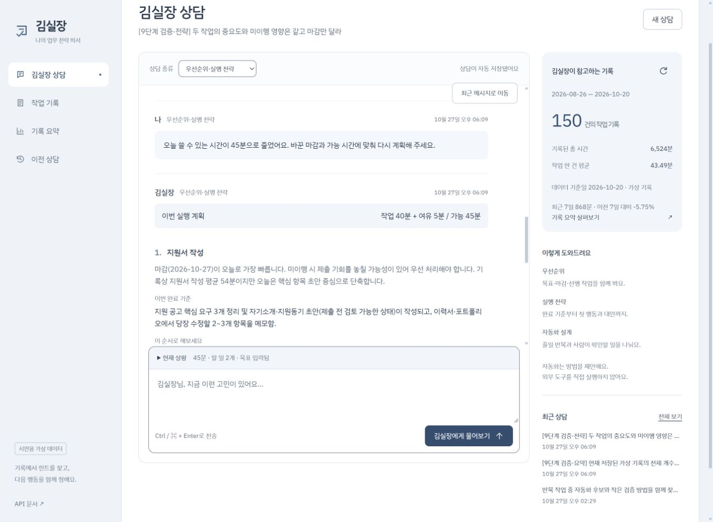
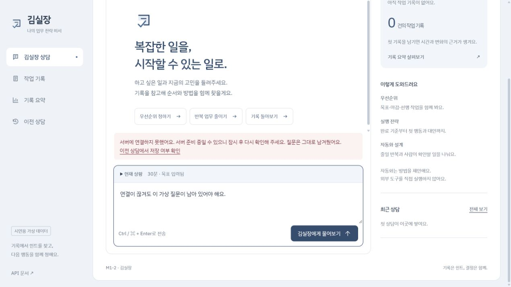

# 9단계 전체 흐름 점검

2026-10-27 로컬 웹 화면(5500), FastAPI(8000), 실제 Firestore와 코디세이 `gpt-5-mini` 연결에서 확인했습니다. 배포 환경의 검증은 10단계에서 진행합니다.

## 결과

| 점검 | 확인 결과 |
| --- | --- |
| 기록 추가 → 목록·요약·상담 | 임시 17분 기록 추가 후 151건·6,541분, 요약 v160. 실제 답변도 같은 수치를 제시 |
| 기록 수정 → 새 상담 근거 | 임시 기록을 31분으로 수정 후 151건·6,555분, v161. 같은 상담의 다음 답변에 반영 |
| 기록 삭제 → 새 상담 근거 | 임시 기록 삭제 후 150건·6,524분, v162. 상담 지침 보완 후 실제 답변에 반영 |
| 마감·가능 시간 변경 | 제안서 오늘/지원서 3일 뒤, 90분 → 제안서 5일 뒤/지원서 오늘, 45분으로 변경. 실행 순서도 제안서 우선 → 지원서 우선으로 변경 |
| 시간 합계 | 최초 작업 85분 + 여유 5분 = 90분. 변경 후 작업 40분 + 여유 5분 = 45분. 각 계획의 작업 ID 누락·중복 없음 |
| 새로고침·이전 상담 재개 | 브라우저 새로고침 후 저장된 90분 상담을 불러와 조건을 복원. 마감만 폼으로 바꾸고 시간은 질문에서 변경해 45분 계획을 저장 |
| 과거 답변 보존 | 이전 90분 계획·당시 조건·근거 버전을 그대로 보존하고, 새 45분 계획과 최신 조건을 추가 저장. 서버 재시작 후에도 API에서 확인 |
| 반복 분석·자동화 구분 | 가상 기록의 반복 작업명·횟수·시간과 Excel→Word→PDF 예시를 구분. 자동화할 단계/사람 검토/작은 시험/미검증 절감 추정을 제시. 외부 도구 실행 없음 |
| 입력 오류·없는 ID | 잘못된 날짜·음수·빈 질문은 422, 없는 상담·기록 수정/삭제는 404. 안전한 한국어 오류 응답 확인 |
| 연결 실패 | 별도 5501/8001 시험 서버에서 응답 없이 연결 종료. 오류 안내·저장 여부 확인 링크를 표시하고 질문·목표·30분 조건을 보존 |
| 키 관리 | Git 공개 후보와 프론트 원본·배포 파일을 실제 키와 메모리 안에서 비교해 일치 없음. `.env`/서비스 계정 파일은 Git 제외·미추적. 웹 접근은 404 |
| CORS·문서 | 허용한 로컬 프론트의 사전 요청 200, 미허용 주소 400·허용 헤더 없음. Swagger `/docs` 200 |

시험 전 작업 기록 150건·6,524분과 기존 상담 8개의 전체 내용을 비교해 변경이 없음을 확인했습니다. 임시 작업 기록은 삭제했습니다. 요약 버전은 데이터 변경 이력을 보존하므로 159 → 162로 증가했습니다.

검증용 상담 3개를 새로 남겼습니다. 최종 상담은 총 11개·메시지 40개입니다. 실제 채팅 요청은 기본 시나리오 6회와 수정 후 재확인 2회, 총 8회였습니다. 이는 앱의 요청 수이며 모델 출력 보정을 위한 내부 호출 수와 같다는 뜻은 아닙니다. 실패했던 답변도 검증용 상담에 과거 이력으로 남아 있습니다.

## 발견해 고친 부분

1. 삭제 직후 최신 요약이 정상적으로 들어갔는데도, 비서가 남은 기록 수와 시간을 사용자에게 다시 물었습니다. 최신 `RECORD_SUMMARY`를 과거 대화보다 우선하고 이미 주어진 통계를 다시 묻지 않도록 상담 규칙을 명확히 했습니다. 같은 질문을 다시 보내 150건·6,524분을 답하는 것을 확인했습니다.
2. 자동화 답변이 사용자 예시를 “기록 수치 근거”로 설명하고 실제 반복 통계를 생략했습니다. 저장된 반복 후보의 작업명과 수치, 사용자 시나리오를 구분하도록 규칙을 보완했습니다. 재확인 답변에서 자료 취합 40건·1,367분 등을 제시하고 예시는 별도로 설계했습니다. 추가 확인 질문이 본문과 질문 목록에 중복되지 않도록 했습니다.

OpenAI Docs 스킬로 [GPT-5 공식 프롬프팅 안내](https://developers.openai.com/cookbook/examples/gpt-5/gpt-5_prompting_guide)의 지침 충돌·확인 질문 기준을 참고했습니다. 모델·키·제공자·호출 방식은 유지했습니다. 이 수정은 상담 지침 개선이며 모든 생성 문장의 정확성을 보장하는 수치 검증기는 아닙니다.

## 자동 시험

Python **218개**, Node **14개** 통과. Python에는 다음 세 통합 시나리오를 추가했습니다.

- 실제 라우터·분석 서비스·요약 주입·저장소 어댑터를 거치는 추가 → 상담 → 수정 → 상담 → 삭제 → 상담. 최신 수치와 과거 근거 보존을 함께 확인합니다.
- 새 앱·저장소 인스턴스에서 대화를 불러오고, 마감 변경과 자연어 시간 변경을 함께 저장합니다. 이전 계획은 보존하고 다음 계획은 시간 한도 내에 있습니다.
- 잘못된 입력·없는 ID는 모델 호출 전에 거절하고, 모델 시간 초과와 생성 후 저장 실패는 부분 메시지를 남기지 않습니다. 복구 뒤 질문 한 번은 메시지 한 쌍만 추가합니다.

```powershell
.\.venv\Scripts\python.exe -m pytest --basetemp=.tmp/pytest-integration -o addopts= --tb=short -q
node --test tests/frontend.test.mjs
.\.venv\Scripts\python.exe scripts/build_frontend.py
```

자동 시험의 Firestore·모델 대역은 실제 클라우드 연결이나 GPT 답변 품질을 증명하지 않습니다. 위 실제 연결 시험으로 별도 확인했습니다. Starlette의 TestClient/httpx 사용 중단 예고 경고 1개가 있으며 시험 실패는 없습니다.

## 화면에서 다시 확인하기

1. 두 로컬 서버를 실행하고 이전 상담에서 `[9단계 검증·전략]` 상담을 엽니다.
2. 초기 90분과 후속 45분 계획, 현재 상황의 마감일·45분을 비교합니다. 상담을 여는 동작은 GPT를 호출하지 않습니다.
3. `[9단계 검증·요약]` 상담에서 151건/6,541분 → 151건/6,555분 → 삭제 후 150건/6,524분과 근거 버전 변화를 확인합니다. 삭제 후 확인 질문이 나온 첫 답변 다음에 수정 후 정상 답변이 있습니다.
4. `[9단계 검증·자동화]` 상담의 후속 답변에서 저장된 통계와 예시 과정, 자동화·사람 확인·미검증 효과를 비교합니다.





## 남은 범위

이 단계는 핵심 기능의 연결과 오류 대응을 확인한 결과입니다. 실제 업무에서 자주 사용할 만큼 도움이 되는지는 별도 개선 항목입니다. 사용자의 실제 작업 한 가지를 기준으로 입력 부담과 답변의 구체성을 평가하는 과정이 필요합니다. 더미데이터의 제출 인정 여부 확인, Render·Vercel 배포와 배포 환경 재점검, 최종 제출 자료는 후속 단계에 남아 있습니다.
