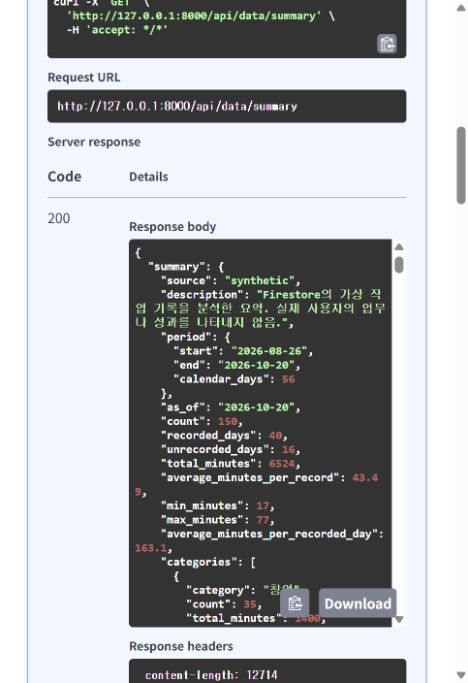

# 김실장 · 5단계 시계열 분석과 요약 API

상태: **구현·실제 Firestore 갱신 검증 완료**. 5단계 시점 128개, 현재 6단계까지 156개 오프라인 테스트를 통과했습니다.

`GET /api/data/summary`는 현재 출처의 전체 작업 기록을 분석합니다. 통계를 계산하는 함수는 Firestore나 GPT를 호출하지 않습니다. 요약 서비스가 원본 버전을 확인하고 계산 결과를 `summaries/synthetic`에 저장합니다. GPT에 이 요약을 전달하는 기능은 7단계에서 연결합니다.

## 1. 사용하는 방법

[Swagger UI](http://127.0.0.1:8000/docs)에서 **GET /api/data/summary → Try it out → Execute**를 선택합니다. 이 요청은 GPT를 호출하지 않습니다.

```powershell
Invoke-RestMethod -Uri 'http://127.0.0.1:8000/api/data/summary'
```

응답은 `summary`, `data_revision`, `generated_at`입니다. `generated_at`은 UTC 생성 시각이고, 분석 기준일 `summary.as_of`는 한국 날짜로 된 마지막 기록일입니다. 첫 조회나 원본 변경 후에는 계산·저장하고, 원본 버전이 같은 다음 조회에서는 저장된 요약을 재사용합니다.

현재 150건의 결과는 다음과 같습니다.

| 지표 | 값 |
| --- | --- |
| 기간·기준일 | 2026-08-26~2026-10-20 / 2026-10-20 |
| 기록 수·기록일·미기록일 | 150건 / 40일 / 16일 |
| 총 소요 시간 | 6,524분 |
| 건당 평균·최소·최대 | 43.49분 / 17분 / 77분 |
| 기록일 평균 | 163.1분 |
| 분야별 시간 비중 | 프리랜서 45.65%, 취업 32.89%, 창업 21.46% |
| 최근 7일 / 이전 7일 | 868분 / 921분 |
| 최근 추세 | `decrease`, -5.75% |
| 반복 검토 후보 예시 | 제안서 작성 20건·1,372분, 예상 대비 1.715배 |

기록된 시간이 줄었다는 사실만으로 효율이나 성과가 좋아졌다고 판단하지 않습니다. 미기록일은 근무 0분이나 휴식으로 처리하지 않습니다. 반복 후보도 자동화 가능성이나 절감 효과를 확정한 결과가 아닙니다.

## 2. 계산 기준

- 기간은 원본의 최소·최대 날짜이고, 분석은 목록 페이지 크기와 관계없이 전체 기록을 사용합니다.
- 평균·퍼센트는 소수점 둘째 자리, 실제/예상 비율은 셋째 자리까지 표시합니다.
- 최근 추세는 마지막 기록일 기준 최근 7일과 이전 7일의 기록된 총 시간을 비교합니다. 반올림 전 변화율이 5%를 넘으면 증가, -5% 미만이면 감소이며 경계값은 유지입니다.
- 전체 기간이 14일 미만이거나 한쪽 구간에 기록이 없으면 `insufficient_data`와 변화율 `null`입니다. 두 구간의 기록 수·기록일 수도 함께 제공합니다.
- 일별 미기록 시간은 `null`, 상태는 `unrecorded`입니다. 7일 구간은 첫 기록일부터 나누고 마지막 부분 구간은 `is_partial: true`로 표시합니다.
- 작업은 같은 분야 안에서 앞뒤 공백을 정리한 이름이 정확히 일치할 때 묶습니다. 같은 이름이라도 분야가 다르면 별도 작업입니다.
- 예상 시간이 있는 기록끼리만 비교합니다. `paired_count`와 `paired_actual_total_minutes`를 전체 건수·총 시간과 구분합니다. 비교할 기록이 없으면 비교 지표는 `null`입니다.
- 같은 작업이 3건 이상이면 누적 시간 내림차순으로 반복 검토 후보에 포함합니다. 원본 `memo`는 요약에 넣지 않습니다.
- 빈 데이터도 정상 `200`입니다. 개수와 총 시간은 0, 날짜·평균·최대·최소는 `null`, 목록은 빈 배열입니다.

기존 [분석 예시](../data/summary.preview.json)의 수치를 모두 비교하는 테스트가 있습니다. 기존 더미데이터 파일은 변경하지 않았습니다.

## 3. 최신 요약을 유지하는 흐름

1. 원본 변경 트랜잭션이 `data_revision`을 증가시키고 `summary_stale: true`로 표시합니다.
2. 요약 서비스는 메타데이터와 저장된 요약을 같은 트랜잭션에서 읽습니다. 버전·스키마·응답 구조가 유효하면 재사용합니다.
3. 새 요약이 필요하면 메타데이터와 전체 원본을 같은 트랜잭션의 일관된 스냅샷으로 읽고 계산합니다.
4. 저장 직전에 원본 버전을 다시 확인합니다. 버전이 같을 때만 요약을 저장하고 `summary_stale: false`로 바꿉니다. 이 두 쓰기는 같은 트랜잭션입니다.
5. 계산 중 원본이 바뀌면 최신 버전으로 다시 시도합니다. 최대 3회 안에 확정하지 못하면 `503 summary_unavailable`을 반환합니다.

저장하는 요약에는 응답 필드와 내부 `schema_version: 1`이 들어갑니다. 요약 갱신 자체는 원본 버전을 올리지 않습니다. 캐시 재사용 시에는 전체 원본을 다시 읽거나 생성 시각을 바꾸지 않습니다. 여러 서버가 실행돼도 최종 저장 여부는 Firestore 버전 검사로 결정합니다.

각 응답은 버전 확인 또는 요약 저장 시점의 일관된 상태입니다. 응답이 돌아오는 동안 다른 요청이 새 기록을 추가할 수 있으며, 다음 요청에서는 새 버전을 확인합니다. 콘솔 등에서 앱의 버전 규칙을 건너뛰어 원본을 직접 수정하는 방식은 지원하지 않습니다.

## 4. CRUD 성공과 요약 실패 구분

추가·수정 성공 후 최신 요약 갱신을 시도합니다. 원본 저장은 성공했으나 요약만 실패하면 원본을 되돌리지 않고 성공 응답에 다음 경고를 포함합니다. 정상 갱신 시 `warning`은 `null`입니다.

```json
{
  "code": "summary_refresh_failed",
  "message": "작업 기록은 저장했지만 최신 요약을 갱신하지 못했습니다. 요약을 다시 조회해 주세요."
}
```

삭제는 본문 없는 `204`를 유지합니다. 삭제 후에도 갱신을 시도하며, 화면은 요약 API를 다시 조회해야 합니다. 갱신 실패 시 원본 버전과 다른 과거 요약을 정상 `200`으로 반환하지 않습니다. 가져오기 도구는 원본 버전과 갱신 필요 표시를 변경하고, 다음 요약 조회에서 재계산합니다.

일별 배열이 무제한 커지지 않도록 전체 분석 기간은 최대 3,660일, 저장할 요약 JSON은 UTF-8 기준 900,000바이트로 제한합니다. 한도를 넘거나 원본 형식·저장소 접근이 잘못되면 요약은 `503`입니다. 원본 저장이 이미 성공한 경우에는 위 경고로 구분합니다.

## 5. 실제 클라우드 검증 — 2026-10-21

| 순서 | 실제 결과 |
| --- | --- |
| 최초 요약 조회·저장 | `200`, 150건·6,524분, 원본 버전 153 |
| 같은 버전 재조회 | 응답과 생성 시각 동일, Firestore 문서와 일치 |
| 임시 기록 7분 추가 | 경고 없음, 151건·6,531분, 버전 154 |
| 임시 기록 11분으로 수정·날짜 이동 | 경고 없음, 151건·6,535분, 버전 155. 예상 시간 누락도 반영 |
| 임시 기록 삭제 | 150건·6,524분으로 복원, 버전 156 |
| 새 서비스·연결로 재조회 | 저장된 요약과 생성 시각 동일 |
| 서버 재시작 후 조회 | 저장된 요약·생성 시각·버전 156 동일, API 버전 0.5.0 확인 |
| 원본 보존 | 기존 150건의 모든 값·생성/수정 시각 동일 |

현재 `metadata/synthetic`의 버전은 156, `summary_stale`은 `false`이며 같은 버전의 `summaries/synthetic`이 저장되어 있습니다. 검증용 기록은 삭제했습니다.



## 6. 역할별 파일과 테스트

| 파일 | 역할 |
| --- | --- |
| `app/services/analysis.py` | DB·AI에 의존하지 않는 시계열 계산 |
| `app/services/summaries.py` | 캐시 검사, 계산 요청, 충돌 재시도와 안전한 오류 |
| `app/repositories/summaries.py` | 요약 저장소 계약과 스냅샷 구조 |
| `app/repositories/firestore_records.py` | 원본·메타데이터·요약을 같은 Firestore 트랜잭션으로 다룸 |
| `app/schemas/summaries.py` | API·저장 결과의 구조 검증 |
| `app/routers/records.py` | 요약 주소와 서비스 연결 |
| `tests/test_summaries.py` | 계산 경계값·캐시·갱신·충돌·실패 시 원본 보존 검사 |

```powershell
.\.venv\Scripts\python.exe -m pytest --basetemp=.tmp/pytest-step5
```

5단계 시점 128개, 6단계 시점 대화 저장을 포함해 156개 테스트를 통과했습니다. 8단계에는 Python 215개·Node 14개가 통과했고 기존 TestClient 전환 예정 경고 1개가 있습니다. 오프라인 테스트는 실제 클라우드 부하나 장애를 증명하지 않습니다. 위 표의 실제 검증은 별도로 실행했습니다. 대화 저장은 [6단계](CONVERSATIONS.md), GPT는 [7단계](CHAT.md), 웹 화면은 [8단계](FRONTEND.md)에서 연결했고 배포는 후속 단계입니다.
